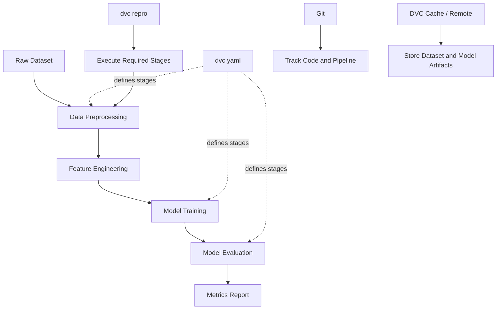
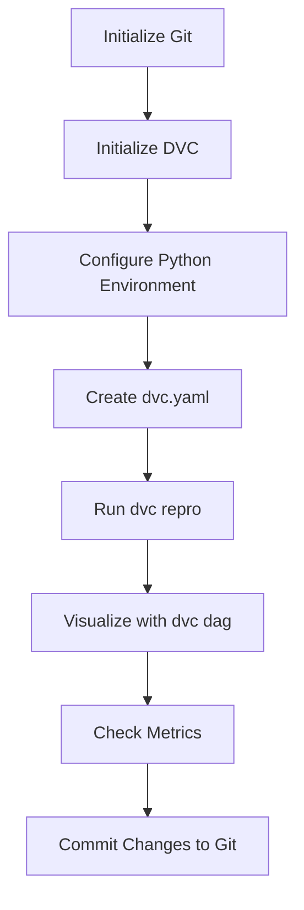

# Build & Track ML Pipeline with DVC

A machine learning project that uses **DVC (Data Version Control)** to build, reproduce, visualize, and track an ML pipeline. DVC helps maintain reproducibility by defining pipeline stages, tracking dependencies, and recording evaluation metrics.
## 🖼️ Project Architecture

### 1. ML Pipeline Architecture

This diagram illustrates the end-to-end machine learning workflow, from raw data to model evaluation.


### 2. DVC Workflow

DVC tracks pipeline stages, dependencies, metrics, and model artifacts, while Git tracks source code and pipeline configuration.



### 3. Pipeline Execution Workflow



### 4. Pipeline Metrics

After running the pipeline, inspect the model evaluation metrics:

```bash
dvc metrics show
```

Example metrics you might track include accuracy, precision, recall, and F1-score. Actual values will depend on your model and dataset.

## 🚀 Project Overview

This project demonstrates how to:

- Set up a Python environment using `uv`.
- Initialize Git and DVC.
- Define an ML pipeline using `dvc.yaml`.
- Reproduce pipeline stages with DVC.
- Visualize pipeline dependencies using `dvc dag`.
- Track and display model evaluation metrics.

## 🛠️ Tech Stack

- **Python** — Machine learning development
- **uv** — Python project and dependency management
- **DVC** — ML pipeline and data version control
- **Git** — Source code version control
- **scikit-learn** — Machine learning algorithms
- **Pandas / NumPy** — Data processing

## 📁 Project Structure

```text
mlops-dvc/
├── data/
│   └── raw/
├── src/
│   ├── data/
│   ├── features/
│   ├── models/
│   └── evaluation/
├── dvc.yaml
├── dvc.lock
├── params.yaml
├── metrics.json
├── requirements.txt
├── pyproject.toml
├── .gitignore
└── README.md
```

*Note: The directory structure is an example. Adjust it to match your actual project.*

## ⚙️ How to Run

### 1. Clone the Repository

```bash
git clone <your-repository-url>
cd mlops-dvc
```

### 2. Initialize the Python Project

If the project has not been initialized yet:

```bash
uv init
uv venv
```

### 3. Activate the Virtual Environment

For Windows PowerShell:

```powershell
.venv\Scripts\Activate.ps1
```

For Windows Command Prompt:

```cmd
.venv\Scripts\activate.bat
```

### 4. Install Dependencies

If your project uses `requirements.txt`:

```bash
uv pip install -r requirements.txt
```

Install DVC if it is not already included in your dependencies:

```bash
uv add dvc
```

If you use a remote storage provider, install the appropriate DVC extra, such as `dvc[s3]` for Amazon S3.

## 🔧 Git and DVC Setup

### 1. Initialize Git

```bash
git init
```

### 2. Initialize DVC

```bash
dvc init
```

### 3. Create the DVC Pipeline

Create a `dvc.yaml` file in the project root. Define the pipeline stages, commands, dependencies, outputs, and metrics according to your ML workflow.

Example:

```yaml
stages:
  train:
    cmd: python src/train.py
    deps:
      - src/train.py
      - data/raw/
    outs:
      - models/model.pkl

  evaluate:
    cmd: python src/evaluate.py
    deps:
      - src/evaluate.py
      - models/model.pkl
    metrics:
      - metrics.json:
          cache: false
```

Make sure the referenced scripts and directories exist before running the pipeline.

## 📊 DVC Commands

### Reproduce the Pipeline

```bash
dvc repro
```

Runs the pipeline stages that need updating based on changed dependencies and outputs.

### Visualize the Pipeline

```bash
dvc dag
```

Displays the dependency graph of the pipeline stages.

### Display Metrics

```bash
dvc metrics show
```

Displays tracked evaluation metrics, provided that the pipeline generates the declared metrics file.

### Check Pipeline Status

```bash
dvc status
```

Shows whether tracked pipeline dependencies or outputs have changed.

### Display Pipeline Parameters

```bash
dvc params show
```

Displays parameters tracked through DVC configuration files such as `params.yaml`.

## 🔄 Typical Workflow

1. Prepare the dataset and ML scripts.
2. Initialize Git and DVC.
3. Define pipeline stages in `dvc.yaml`.
4. Run `dvc repro` to execute the pipeline.
5. Inspect dependencies with `dvc dag`.
6. Review model metrics with `dvc metrics show`.
7. Commit the pipeline definition and lock file to Git.

## 📈 Benefits of DVC

- **Reproducibility:** Rerun pipeline stages consistently.
- **Pipeline automation:** Define dependencies between ML tasks.
- **Experiment tracking:** Compare metrics and parameters across experiments.
- **Version control:** Track code with Git and data/model artifacts with DVC.
- **Dependency visualization:** Understand the relationship between pipeline stages.

## 📝 Important Notes

- Commit `dvc.yaml` and `dvc.lock` to Git when appropriate.
- Large datasets and model artifacts can be tracked with DVC instead of storing them directly in Git.
- Configure a DVC remote if you need to share cached data and model artifacts with collaborators.
- Ensure all scripts, datasets, and output paths referenced in `dvc.yaml` exist.
- `dvc metrics show` requires a valid metrics file produced by your pipeline.

## 👨‍💻 Author

**Subhasish Sahoo**

GitHub: [SubhasishElixor-HQ](https://github.com/SubhasishElixor-HQ)

---

**Built to learn and practice MLOps using DVC, Git, and Python.**
